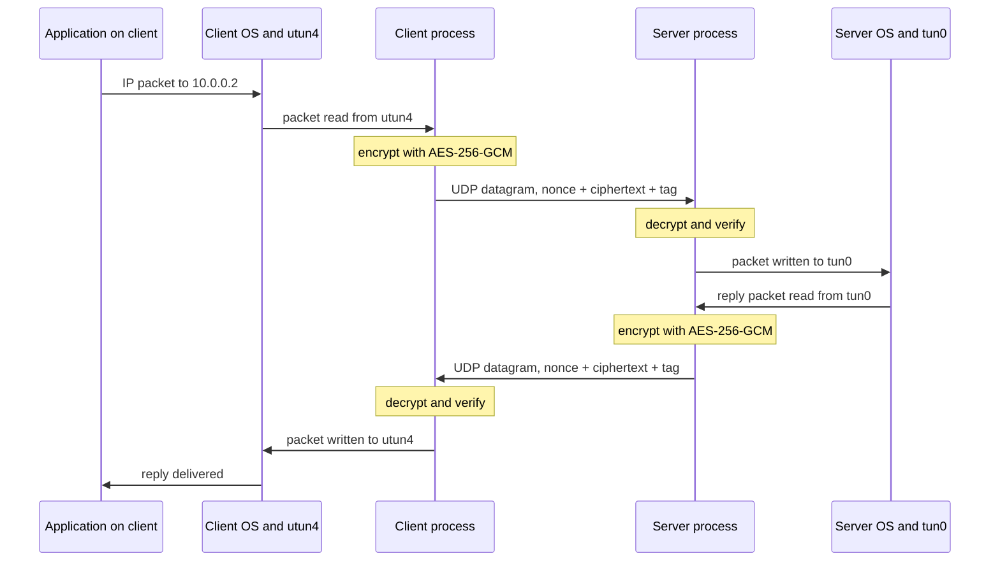

# p2p-vpn

A point-to-point Layer 3 VPN written in Go. It carries IP packets between one client and one server through a TUN interface, encrypting each packet with AES-256-GCM and sending it over UDP. The project is a learning implementation of a VPN data path: packet capture at the OS level, tunneling, authenticated encryption and a two-goroutine forwarding pipeline.

## Features

- Layer 3 tunnel between one client and one server, built on a TUN interface on both ends
- UDP transport: one UDP datagram carries exactly one IP packet, so no framing is needed
- AES-256-GCM authenticated encryption of every packet, with a fresh random 96-bit nonce per packet
- Datagrams that fail authentication (wrong key, modified data) are logged and dropped
- Key supplied at start-up through the `--key` flag (32 bytes, hex-encoded); it is not compiled into the binary
- Batched reads from the TUN device (up to 32 packets per read)
- Server learns the client address from authenticated datagrams, so the client may change address without restarting the server
- The same forwarding code (`internal/tunnel`) runs on both client and server
- TUN interface name is chosen by OS: `utun4` on macOS, `tun0` on Linux
- Unit tests for the encryption package

## How it works



Datagram layout (UDP payload):

```
| nonce (12 bytes) | encrypted IP packet | GCM tag (16 bytes) |
```

Step by step:

1. An application sends traffic to an address that the OS routes into the TUN interface (for example `10.0.0.2`).
2. The tunnel reads the IP packet from the TUN device (`tunToUDP`).
3. The packet is encrypted with AES-256-GCM using a random nonce, which is prepended to the ciphertext.
4. The result is sent as one UDP datagram to the peer.
5. The peer receives the datagram (`udpToTun`), splits off the nonce and decrypts. If authentication fails, the datagram is dropped.
6. The decrypted IP packet is written to the peer's TUN device, and the OS handles it as if it had arrived from a network.

The return path is identical with the roles swapped. Each process runs two loops: `tunToUDP` in a separate goroutine and `udpToTun` on the main goroutine.

The client knows the server address from `--server` and `--port`. The server does not know the client address at start-up: it stores the source address of each successfully decrypted datagram and uses it as the destination for outgoing packets. Until the first valid datagram arrives, packets read from the server's TUN device are discarded.

## Tech stack and key decisions

- **Go**, standard library only, except for the TUN package.
- **TUN (Layer 3) instead of TAP.** The program reads and writes plain IP packets, so there are no Ethernet frames or MAC addresses to handle, and the OS routing table decides what enters the tunnel.
- **UDP instead of TCP.** A datagram maps one-to-one to an IP packet, which removes the need for length-prefix framing. The tunnel itself does no retransmission; reliability for inner TCP traffic is left to the inner TCP connections.
- **AES-256-GCM (`crypto/aes`, `crypto/cipher`).** An authenticated mode provides confidentiality and integrity in one primitive, so a modified datagram is rejected instead of being injected into the TUN device. The nonce is generated with `crypto/rand` for every packet and sent in front of the ciphertext. Per-packet overhead is 28 bytes (12-byte nonce + 16-byte tag).
- **`golang.zx2c4.com/wireguard/tun`.** A maintained TUN implementation from the WireGuard project that supports macOS (`utun`) and Linux (`/dev/net/tun`) behind one API with batched `Read` and `Write`. Only the `tun` package is used. `songgao/water` was not chosen because it is no longer maintained.
- **MTU 1420.** The encrypted datagram must fit into a 1500-byte link MTU: 1420 bytes of inner packet + 28 bytes of encryption overhead + 8 bytes of UDP header + 20 bytes of IPv4 header = 1476 bytes, which leaves headroom and avoids fragmentation.

## Project structure

```
.
├── cmd/
│   ├── client/main.go      # client entry point: flags, UDP socket, starts the tunnel
│   └── server/main.go      # server entry point: flags, UDP listener, starts the tunnel
├── internal/
│   ├── crypto/
│   │   ├── crypto.go       # AES-256-GCM: NewAEAD, Encrypt, Decrypt
│   │   └── crypto_test.go  # unit tests
│   ├── tun/tun.go          # TUN creation, batched read/write helpers, constants (MTU, buffer sizes)
│   └── tunnel/tunnel.go    # the two forwarding loops: TUN -> UDP and UDP -> TUN
├── go.mod
└── go.sum
```

## Requirements

- Go 1.26.1 or newer (the version in `go.mod`)
- macOS (Apple Silicon) for the client and Linux with `/dev/net/tun` for the server; these are the platforms the code has been run on
- Root privileges on both sides (creating a TUN device and configuring interfaces)
- `openssl` (optional, for key generation) and `ping`

## Build

macOS (client and server for the local machine):

```bash
go build -o bin/client ./cmd/client
go build -o bin/server ./cmd/server
```

Linux server, cross-compiled from macOS:

```bash
GOOS=linux GOARCH=amd64 go build -o bin/server-linux ./cmd/server
GOOS=linux GOARCH=arm64 go build -o bin/server-linux ./cmd/server
```

Use the line that matches the server CPU architecture.

## Usage

Generate a 32-byte key and use the same value on both sides:

```bash
openssl rand -hex 32
```

### Flags

| Flag       | Used by          | Default | Description                                              |
|------------|------------------|---------|----------------------------------------------------------|
| `--server` | client           | none    | Address of the server                                    |
| `--port`   | client, server   | `2000`  | UDP port: the server listens on it, the client sends to it |
| `--key`    | client, server   | none    | AES-256 key, 64 hex characters (32 bytes); required      |

The TUN interface name is fixed in code: `utun4` on macOS, `tun0` on Linux. The program creates the interface but does not assign addresses or routes; this is done manually.

### Server (Linux)

Make sure the UDP port is reachable (firewall, security group). Start the server:

```bash
sudo ./bin/server-linux --port 2000 --key <KEY>
```

In a second terminal, configure the interface:

```bash
sudo ip addr add 10.0.0.2/24 dev tun0
sudo ip link set tun0 up
```

### Client (macOS)

```bash
sudo ./bin/client --server <SERVER_IP> --port 2000 --key <KEY>
```

In a second terminal, configure the interface:

```bash
sudo ifconfig utun4 10.0.0.1 10.0.0.2 up
```

### Verify

On the client:

```bash
ping 10.0.0.2
```

Replies mean that packets pass through the encrypted tunnel in both directions. Start traffic from the client: the server learns the client address from the first authenticated datagram and cannot send before that.

## Testing

```bash
go test ./...
```

Tests exist for `internal/crypto` only. They cover:

- encrypt/decrypt round trip for empty, 1-byte, text, 64-byte and MTU-sized (1420-byte) payloads
- a different nonce for every encryption of the same plaintext
- decryption with a wrong key fails
- decryption fails after changing a nonce, ciphertext or tag byte, truncating the tag or appending a byte

The TUN and tunnel packages require root and a real network interface and have no automated tests.

## Status

Verified:

- Tunnel between a macOS client and an Ubuntu Server virtual machine (UTM): `ping 10.0.0.2` through the encrypted tunnel succeeds.

Not verified:

- Routing all client traffic through the tunnel
- NAT and IP forwarding on a real VPS

The program does not configure routing or NAT, so a full-tunnel setup is currently outside the code. If the default route is ever pointed into the tunnel, a host route to the server through the physical gateway is required; otherwise encrypted datagrams would be routed back into the TUN device.

## Limitations and security notes

- **One client only.** The server keeps a single peer address. A second client using the same key would overwrite it.
- **Pre-shared key, no key exchange.** Both sides use the same key for both directions. There is no handshake, authentication of peers beyond possession of the key, key rotation or forward secrecy.
- **Key is passed on the command line.** It can be visible in the process list and shell history.
- **No replay protection.** Nonces are random and not tracked; a captured datagram that is sent again is decrypted and written to the TUN device again. Because the server updates the peer address from every authenticated datagram, a replayed datagram sent from another source address also changes where the server sends its replies.
- **No direction separation.** Both directions use the same key with no additional authenticated data, so a datagram from one side is also valid if it is delivered back to its sender.
- **Random nonces without a limit.** The project does not count packets or rekey. NIST SP 800-38D limits random 96-bit nonces to 2^32 encryptions per key.
- **Minimal input validation.** The receive path does not check the datagram length before decrypting, so a datagram shorter than the 12-byte nonce terminates the process.
- **IPv4 only in practice.** Addressing and the documented setup use IPv4. The code forwards packets without inspecting them, but IPv6 through the tunnel is not configured or tested.
- **Manual setup.** Interface addresses, routes, firewall rules and NAT are not managed by the program, and interface names are not configurable.
- **No graceful shutdown, metrics or log levels.** Errors are written to standard output through `log`.
- **Not audited.** This is a learning project and is not intended for protecting real traffic.

## Possible next steps

- Validate datagram length before decrypting and add a test for short datagrams
- Add replay protection: a per-direction packet counter as the nonce and a sliding window on the receiver
- Verify full-tunnel routing and NAT on a real VPS and document the setup, or let the program configure addresses and routes
- Replace the pre-shared key with a handshake that derives per-session keys
- Add tests for the tunnel package using a fake TUN device, and measure throughput with `iperf3`
